<p align="center">
  
</p>

<h1 align="center">📡 Customer Churn Prediction — Multi-Algorithm Classification Showdown</h1>
<p align="center">
  <b>IBM Telco Customer Churn Dataset</b> · Supervised Learning · KNN vs Naive Bayes vs SVM vs Decision Tree<br>
  <i>Red &amp; White Skill Education | Practical Exam | Supervised Learning — Set B | ⏱ 6 Hours</i>
</p>

<!-- ============================================================ -->
<!--  QUICK-ACCESS BUTTONS                                        -->
<!--  TODO: replace the Project Question / Theory PDF / Video    -->
<!--  links below with your own hosted URLs if different.        -->
<!-- ============================================================ -->
<p align="center">
  <a href="https://github.com/jeelprajapati0606/customer_churn_prediction/blob/main/Customer_Churn_Prediction/telco_customer_churn-checkpoint.ipynb"></a>
  <a href="https://colab.research.google.com/github/jeelprajapati0606/customer_churn_prediction/blob/main/Customer_Churn_Prediction/telco_customer_churn-checkpoint.ipynb"></a>
  <a href="https://www.kaggle.com/datasets/blastchar/telco-customer-churn"></a>
  <a href="https://raw.githubusercontent.com/jeelprajapati0606/customer_churn_prediction/main/Customer_Churn_Prediction/WA_Fn-UseC_-Telco-Customer-Churn.csv"></a>
  <a href="https://github.com/jeelprajapati0606/customer_churn_prediction"></a>
  <a href="https://github.com/jeelprajapati0606/customer_churn_prediction"></a>
  <a href="https://github.com/jeelprajapati0606/customer_churn_prediction"></a>
</p>

<p align="center">
  
  
  
  
  
  
  
  
  
</p>

---

## 📋 Table of Contents

- [📖 Project Overview](#-project-overview)
- [🎯 Learning Objectives](#-learning-objectives)
- [🧾 Exam at a Glance](#-exam-at-a-glance)
- [🗂️ Repository Structure](#️-repository-structure)
- [🛠️ Tech Stack](#️-tech-stack)
- [🔄 End-to-End Workflow](#-end-to-end-workflow)
- [🧠 ML Pipeline Architecture](#-ml-pipeline-architecture)
- [🧩 Step 1 — Problem Framing & Theory Notes](#step-1)
- [📊 Step 2 — Dataset Loading & EDA](#step-2)
- [🧹 Step 3 — Preprocessing & Feature Engineering](#step-3)
- [🤖 Step 4 — KNN & Naive Bayes](#step-4)
- [⚔️ Step 5 — SVM & Decision Tree](#step-5)
- [🏆 Step 6 — Model Evaluation & Comparison](#step-6)
- [🔍 Step 7 — Error Analysis & Interpretation](#step-7)
- [🚀 Step 8 — Pipeline, Deployment & Submission](#step-8)
- [📈 Final Results Dashboard](#-final-results-dashboard)
- [💼 Business Recommendation](#-business-recommendation)
- [▶️ How to Run](#️-how-to-run)
- [✅ Exam Submission Checklist](#-exam-submission-checklist)
- [👨‍💻 Author](#-author)

---

## 📖 Project Overview

> You are working as a **Junior Data Scientist at a telecom company similar to Jio or Airtel**. The retention team has escalated a critical business problem: **the company is losing paying subscribers every month and cannot predict who is about to leave.**

This project uses the **IBM Telco Customer Churn** dataset — a widely used industry benchmark that mirrors real subscriber data — to build and compare **multiple Supervised Learning classification models** that predict whether a customer will **churn** (leave the service) or be **retained**. The goal is to help the retention team decide **which model to deploy in production**.

<p align="center">
  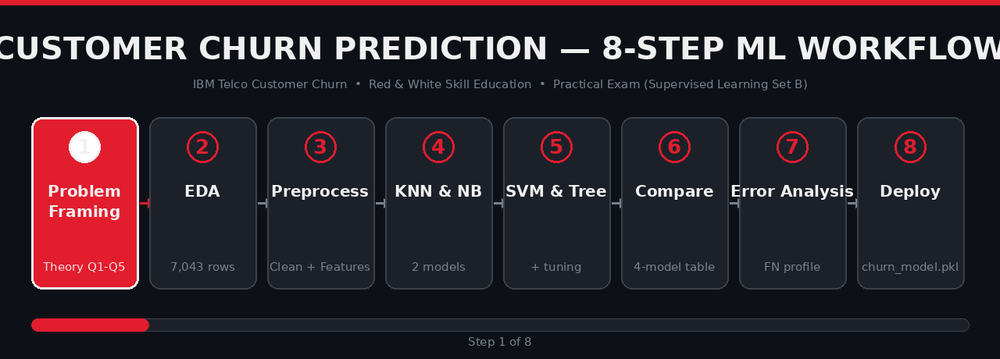
</p>

<details>
<summary>🎬 What this project does, in one minute</summary>

1. **Frames** the churn problem in business terms (CAC vs CLV, cost of False Negatives).
2. **Explores** 7,043 customers × 21 features and finds the highest-risk segment: *Month-to-month contract + high MonthlyCharges + low tenure*.
3. **Cleans & engineers** features (`tenure_group`, `num_services`, `AutoPay`), encodes categoricals, scales numerics.
4. **Balances** the imbalanced target (26.5% churn) with **SMOTE — on the training set only**.
5. **Trains & tunes 4 classifiers**: KNN, Gaussian Naive Bayes, SVM (RBF), Decision Tree.
6. **Compares** them on Accuracy / Precision / **Recall** / F1 / AUC-ROC / training time.
7. **Analyzes errors** (False Negatives) and extracts business insights from feature importance.
8. **Packages** the winner into a reproducible `sklearn.Pipeline` → `churn_model.pkl` and submits via GitHub.

</details>

---

## 🎯 Learning Objectives

By completing this exam, the notebook demonstrates:

- ✅ Framing a real-world churn prediction problem from a **business and ML perspective**
- ✅ **EDA** on a small, structured, real-world dataset with mixed feature types
- ✅ Hands-on implementation of **KNN, Naive Bayes, SVM, and Decision Tree** classifiers
- ✅ Handling **class imbalance** using `class_weight` and **SMOTE**
- ✅ Rigorous model evaluation: **confusion matrix, precision–recall tradeoff, ROC-AUC**
- ✅ Choosing the right model based on **business cost of false negatives vs false positives**
- ✅ Packaging and submitting a clean, **reproducible ML project via GitHub**

---

## 🧾 Exam at a Glance

| Item | Detail |
|---|---|
| 🎓 Institute | Red & White Skill Education |
| 📝 Exam Type | **Practical** |
| ⏱ Duration | **6 Hours** |
| 📘 Topic | Supervised Learning — Set B |
| 📊 Dataset | **IBM Telco Customer Churn** ([Kaggle](https://www.kaggle.com/datasets/blastchar/telco-customer-churn)) |
| 📥 File | `WA_Fn-UseC_-Telco-Customer-Churn.csv` |
| 👥 Rows | **7,043 customers** |
| 🧱 Features | **21 columns** (demographics, services, contract, billing, churn) |
| 🎯 Target | `Churn` — `Yes` = churned, `No` = retained (binary classification) |
| ⚖️ Class balance | **No: 73.46%** (5,174) · **Yes: 26.54%** (1,869) → **imbalanced** |
| 🤖 Models | KNN · Gaussian Naive Bayes · SVM (RBF) · Decision Tree |
| ⚠️ Key rule | SMOTE is fit **only on the training set** — the test set stays original |

### Dataset schema (21 columns)

| # | Column | Type | Meaning |
|---|---|---|---|
| 1 | `customerID` | id | Unique customer identifier (dropped — no predictive value) |
| 2 | `gender` | cat | Female / Male |
| 3 | `SeniorCitizen` | num | 1 if senior citizen |
| 4 | `Partner` | cat | Has a partner |
| 5 | `Dependents` | cat | Has dependents |
| 6 | `tenure` | num | Months with the company |
| 7 | `PhoneService` | cat | Phone service active |
| 8 | `MultipleLines` | cat | Multiple lines |
| 9 | `InternetService` | cat | DSL / Fiber optic / No |
| 10 | `OnlineSecurity` | cat | Add-on |
| 11 | `OnlineBackup` | cat | Add-on |
| 12 | `DeviceProtection` | cat | Add-on |
| 13 | `TechSupport` | cat | Add-on |
| 14 | `StreamingTV` | cat | Add-on |
| 15 | `StreamingMovies` | cat | Add-on |
| 16 | `Contract` | cat | Month-to-month / One year / Two year |
| 17 | `PaperlessBilling` | cat | Yes / No |
| 18 | `PaymentMethod` | cat | Electronic check, Mailed check, Bank transfer (auto), Credit card (auto) |
| 19 | `MonthlyCharges` | num | Monthly bill |
| 20 | `TotalCharges` | num | **Loads as object** (whitespace rows) → converted to `float64` |
| 21 | `Churn` | 🎯 | Yes / No — target |

---

## 🗂️ Repository Structure

```
customer_churn_prediction/
├── README.md                          👈 this file (you are here)
├── requirements.txt                   👈 pip install -r requirements.txt
├── churn_model.pkl                    🤖 trained pipeline saved with joblib (Step 8)
├── assets/
│   ├── banner.jpg                     🎨 hero banner
│   ├── workflow.gif                   🎞 animated 8-step workflow
│   ├── results.gif                    🎞 animated model-showdown bars
│   └── plots/                         📊 real plots generated by the notebook
│       ├── churn_countplot.png
│       ├── histograms.png
│       ├── categorical_countplots.png
│       ├── contract_churn_rate.png
│       ├── tenure_bucket_churn.png
│       ├── monthlycharges_vs_churn_boxplot.png
│       ├── correlation_heatmap.png
│       ├── knn_k_tuning.png
│       ├── knn_confusion_matrix.png
│       ├── knn_roc_curve.png
│       ├── nb_confusion_matrix.png
│       ├── nb_roc_curve.png
│       ├── svm_confusion_matrix.png
│       ├── svm_roc_curve.png
│       ├── dt_confusion_matrix.png
│       ├── dt_tree_visualization.png
│       ├── dt_feature_importance_top15.png
│       ├── dt_roc_curve.png
│       ├── roc_comparison_all_models.png
│       ├── precision_vs_recall.png
│       ├── dt_top5_features.png
│       └── permutation_importance_top10.png
└── Customer_Churn_Prediction/
    ├── WA_Fn-UseC_-Telco-Customer-Churn.csv        📊 dataset (7,043 rows)
    └── telco_customer_churn-checkpoint.ipynb       📓 the full exam notebook (188 cells)
```

> 💡 **Note:** keep the `assets/` folder in the **same directory as this README** on GitHub so all images/GIFs render.

---

## 🛠️ Tech Stack

| Layer | Tools |
|---|---|
| Data | `pandas`, `numpy` |
| Visualization | `matplotlib`, `seaborn` |
| ML | `scikit-learn` (KNN, GaussianNB, SVC, DecisionTree, metrics, pipeline, inspection) |
| Imbalance | `imbalanced-learn` (**SMOTE**) |
| Serialization | `joblib` → `churn_model.pkl` |
| Environment | Jupyter Notebook / Google Colab, Python 3.11 |

---

## 🔄 End-to-End Workflow

<p align="center">
  
</p>

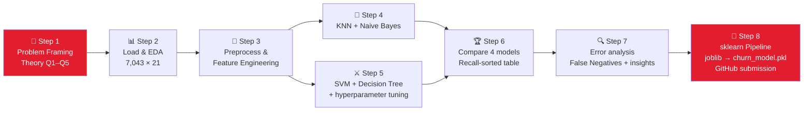

## 🧠 ML Pipeline Architecture

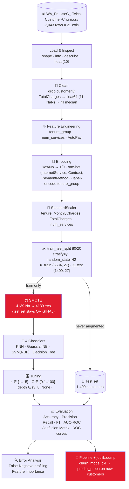

### Confusion matrix — the business cost view

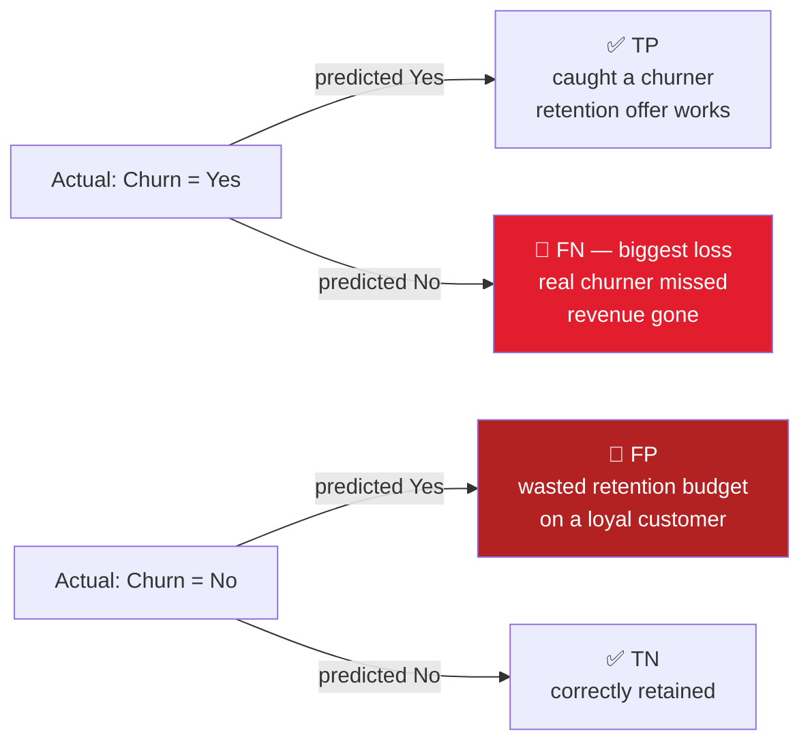

> 💼 **Business framing from the exam:** Jio's retention team can call ~500 customers/day. If the model flags 2,000 likely churners, they can only act on 25%. **Precision matters too** — but missing a real churner (False Negative) is the bigger loss. Hence **Recall for the Churn class is the primary metric**, balanced against precision and latency.

---

<a id="step-1"></a>
## 🧩 Step 1 — Problem Framing & Theory Notes *(Notebook: PART A, cells 1–11)*

The notebook opens with five theory questions answered as Markdown cells before any code:

<details>
<summary><b>Q1. What is Customer Churn? Why predict it for Jio/Airtel? (CAC vs CLV)</b></summary>

- **Customer churn** = when a customer stops using a company's product/service (e.g., a Jio customer switches to Airtel).
- Predicting churn lets the company **identify at-risk customers early** and offer discounts / better service to retain them.
- **CAC** (Customer Acquisition Cost) = money spent to win a new customer. **CLV** (Customer Lifetime Value) = total revenue expected from a customer over their lifetime.
- **Retaining an existing customer is much cheaper than acquiring a new one** — that is why churn prediction is high-value.

</details>

<details>
<summary><b>Q2. The four cells of a Confusion Matrix + business cost in churn context</b></summary>

| | Predicted: No Churn | Predicted: Churn |
|---|---|---|
| **Actual: No Churn** | TN — correctly retained | FP — wasted retention offer |
| **Actual: Churn** | **FN — missed churner (revenue loss!)** | TP — churner caught in time |

- **False Negative** = company misses a customer who is actually leaving → **loss of revenue**.
- **False Positive** = company contacts a customer who was not going to leave → **wasted time & retention resources**.

</details>

<details>
<summary><b>Q3. Class imbalance & SMOTE</b></summary>

- **Class imbalance** = one class has significantly more samples than the other. The Telco dataset has it: **No 73.46% vs Yes 26.54%**.
- **SMOTE** (Synthetic Minority Over-sampling Technique) creates **synthetic minority-class samples** to balance training.
- ⚠️ **SMOTE is applied only to training data, never to the test set** (avoids data leakage).

</details>

<details>
<summary><b>Q4. How the 4 algorithms work</b></summary>

- **KNN** — predicts a new point's class by majority vote among its **k nearest neighbors** (distance-based → scaling matters).
- **Naive Bayes** — Bayes' theorem with a **feature-independence assumption**; GaussianNB assumes each feature is normally distributed.
- **SVM** — finds the **maximum-margin hyperplane** separating classes (RBF kernel handles non-linear boundaries).
- **Decision Tree** — tree of **if/else feature splits** leading to a prediction (human-interpretable).

</details>

<details>
<summary><b>Q5. When choose Precision over Recall?</b></summary>

- **Precision** matters when **False Positives are costly** — e.g., limited retention budget, you only want to contact *highly likely* churners.
- **Recall** matters when you must catch **as many real churners as possible** — in churn, missing an actual churner (FN) is usually the bigger business loss, so **Recall is the primary metric here**.

</details>

---

<a id="step-2"></a>
## 📊 Step 2 — Dataset Loading & Exploratory Data Analysis *(PART B, cells 12–46)*

### 2.1 Load & Inspect

<details>
<summary>📌 Main code — load, inspect, fix TotalCharges, check class balance</summary>

```python
import pandas as pd
import numpy as np
import matplotlib.pyplot as plt
import seaborn as sns
import warnings
warnings.filterwarnings('ignore')

df = pd.read_csv("WA_Fn-UseC_-Telco-Customer-Churn.csv")
print("Dataset Shape:", df.shape)   # (7043, 21)
df.info(); df.describe(); df.head(10)

# TotalCharges loads as object because some rows contain whitespace " "
print("Before Conversion:", df['TotalCharges'].dtype)          # str
df['TotalCharges'] = pd.to_numeric(df['TotalCharges'], errors='coerce')
print("After Conversion:", df['TotalCharges'].dtype)           # float64
print("Missing Values:", df['TotalCharges'].isnull().sum())    # 11

# Class balance
print(df['Churn'].value_counts())
print(df['Churn'].value_counts(normalize=True) * 100)
```

```text
Dataset Shape: (7043, 21)
Before Conversion: str
After Conversion: float64
Missing Values: 11

Churn
No     5174
Yes    1869
Churn Percentage:
No     73.463013
Yes    26.536987   ← imbalanced! handle with SMOTE / class_weight
```

</details>

### 2.2 Univariate analysis

<p align="center">
  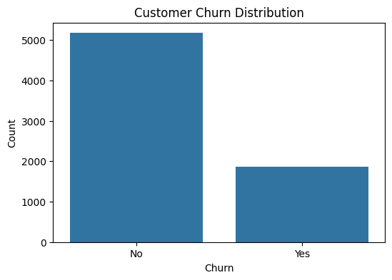
  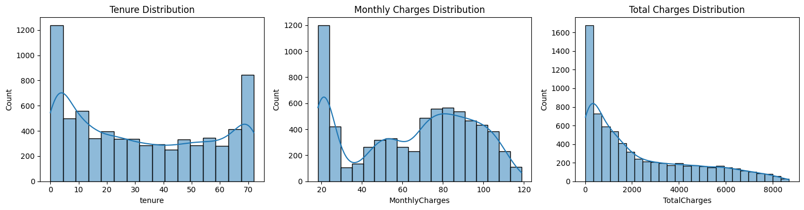
</p>
<p align="center">
  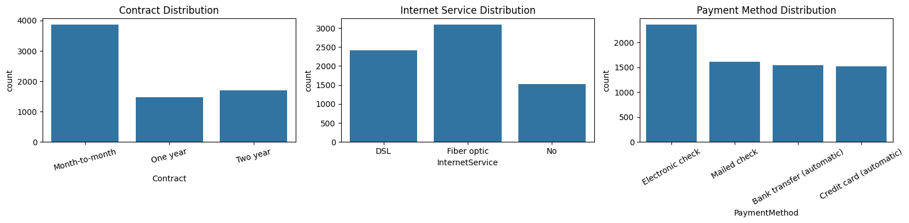
</p>

- Countplot of `Churn` → visual confirmation of the **26.5% / 73.5% imbalance**.
- Histograms of `tenure`, `MonthlyCharges`, `TotalCharges` → tenure is heavily concentrated at low values (many new customers), MonthlyCharges is spread out.
- Countplots of `Contract`, `InternetService`, `PaymentMethod`, … → most customers are **Month-to-month** and pay by **Electronic check**.

### 2.3 Bivariate analysis — where the churn lives

<details>
<summary>📌 Main code — churn rate by contract, tenure bucket, boxplot, heatmap</summary>

```python
# Churn rate by Contract type
contract_churn = pd.crosstab(df['Contract'], df['Churn'], normalize='index') * 100
print(contract_churn)

# Churn rate by tenure bucket
df['tenure_bucket'] = pd.cut(df['tenure'], bins=[-1, 12, 24, 48, 72],
                             labels=['0-12', '13-24', '25-48', '49-72'])
tenure_churn = pd.crosstab(df['tenure_bucket'], df['Churn'], normalize='index') * 100
print(tenure_churn)

# Boxplot: MonthlyCharges vs Churn
sns.boxplot(data=df, x='Churn', y='MonthlyCharges')

# Correlation heatmap of numeric features
numeric_df = df.select_dtypes(include=np.number)
sns.heatmap(numeric_df.corr(), annot=True, cmap='coolwarm', fmt='.2f')
```

```text
Churn               No       Yes
Contract
Month-to-month  57.29%   42.71%   ← churns the most!
One year        88.73%   11.27%
Two year        97.17%    2.83%

Churn              No       Yes
tenure_bucket
0-12           52.56%   47.44%   ← highest churn
13-24          71.29%   28.71%
25-48          79.61%   20.39%
49-72          90.49%    9.51%
```

</details>

<p align="center">
  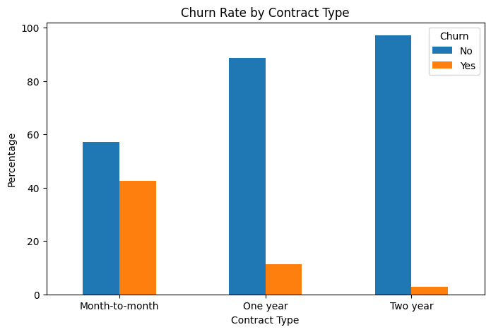
  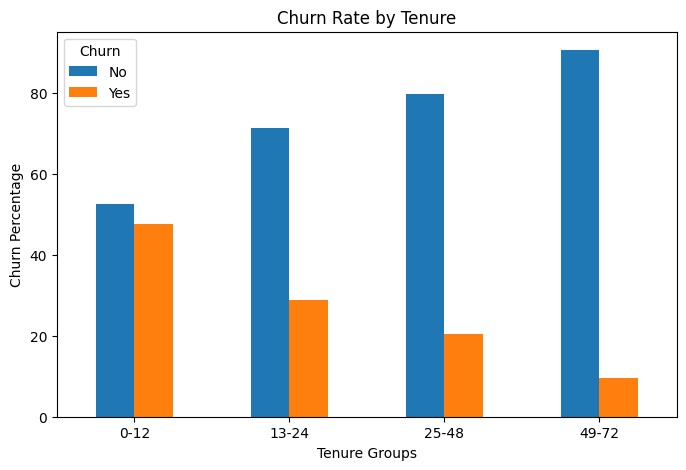
</p>
<p align="center">
  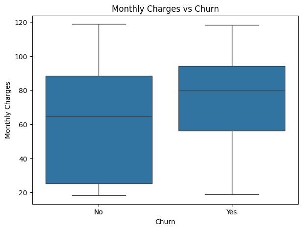
  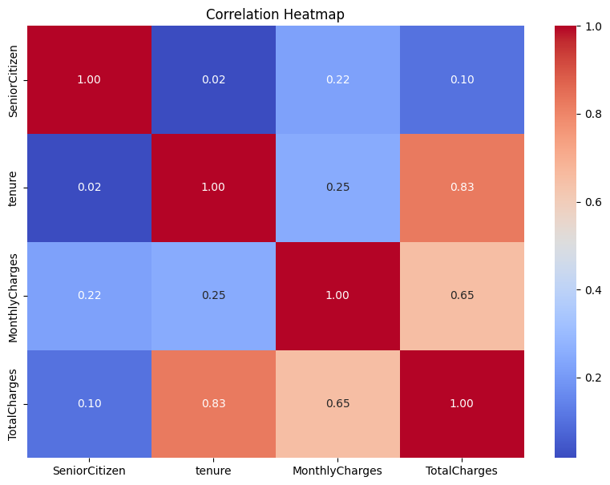
</p>

> 💡 **Key insight (confirmed by EDA):** **Month-to-month contract customers with high MonthlyCharges and low tenure are the highest-risk churn segment.** Contract type churns at **42.7%** vs **2.8%** for two-year contracts; the 0–12 month bucket churns at **47.4%**. Churners also pay slightly more per month on average.

---

<a id="step-3"></a>
## 🧹 Step 3 — Data Preprocessing & Feature Engineering *(PART C, cells 47–80)*

### 3.1 Drop & Clean

<details>
<summary>📌 Main code — drop customerID, fill TotalCharges NaN with median</summary>

```python
df = df.drop('customerID', axis=1)          # unique identifier, no predictive value
df.isnull().sum()                            # only TotalCharges has 11 NaNs
df['TotalCharges'] = df['TotalCharges'].fillna(df['TotalCharges'].median())
```

</details>

### 3.2 Feature Engineering

<details>
<summary>📌 Main code — tenure_group, num_services, AutoPay</summary>

```python
# 1) tenure_group: New (0-12), Mid (13-36), Senior (37-60), Loyal (61+)
df['tenure_group'] = pd.cut(df['tenure'], bins=[-1, 12, 36, 60, 100],
                            labels=['New', 'Mid', 'Senior', 'Loyal'])

# 2) num_services: how many add-on services the customer has (count of 'Yes')
service_columns = ['OnlineSecurity', 'OnlineBackup', 'DeviceProtection',
                   'TechSupport', 'StreamingTV', 'StreamingMovies']
df['num_services'] = (df[service_columns] == 'Yes').sum(axis=1)

# 3) AutoPay: 1 if PaymentMethod contains 'automatic', else 0
df['AutoPay'] = df['PaymentMethod'].str.contains('automatic', case=False).astype(int)
```

</details>

### 3.3 Encoding

<details>
<summary>📌 Main code — binary map, one-hot, label encoding</summary>

```python
# Normalize service placeholders, then binary Yes/No -> 1/0
df = df.replace({'No internet service': 'No', 'No phone service': 'No'})
df = df.replace({'Yes': 1, 'No': 0})
df['gender'] = df['gender'].map({'Female': 0, 'Male': 1})

# One-hot for nominal multi-class columns (drop_first to avoid dummy trap)
df = pd.get_dummies(df, columns=['InternetService', 'Contract', 'PaymentMethod'],
                    drop_first=True, dtype=int)

# Label encoding for the ORDINAL tenure_group (order matters: New < Mid < Senior < Loyal)
tenure_mapping = {'New': 0, 'Mid': 1, 'Senior': 2, 'Loyal': 3}
df['tenure_group'] = df['tenure_group'].map(tenure_mapping)

# EDA helper column is no longer needed
if 'tenure_bucket' in df.columns:
    df = df.drop('tenure_bucket', axis=1)
```

</details>

### 3.4 Scaling — StandardScaler

> `Z = (X − μ) / σ` — puts all numerics on a common scale. **KNN and SVM are distance-based → scaling is essential**; Decision Tree and Naive Bayes don't need it, but we scale uniformly for a fair comparison.

<details>
<summary>📌 Main code — scale, split 80/20 stratified, SMOTE on train only</summary>

```python
from sklearn.model_selection import train_test_split
from sklearn.preprocessing import StandardScaler
from imblearn.over_sampling import SMOTE

X = df.drop('Churn', axis=1)
y = df['Churn'].astype(int)

X_train, X_test, y_train, y_test = train_test_split(
    X, y, test_size=0.20, random_state=42, stratify=y)
# X_train (5634, 27) · X_test (1409, 27)

scaler = StandardScaler()
scale_columns = ['tenure', 'MonthlyCharges', 'TotalCharges', 'num_services']
X_train[scale_columns] = scaler.fit_transform(X_train[scale_columns])   # fit on TRAIN
X_test[scale_columns]  = scaler.transform(X_test[scale_columns])        # only transform test

# ⚠️ SMOTE only AFTER the split, only on TRAIN — test set stays original!
smote = SMOTE(random_state=42)
X_train_smote, y_train_smote = smote.fit_resample(X_train, y_train)
print(y_train_smote.value_counts())
```

```text
Class Counts After SMOTE:
Churn
0    4139
1    4139   ← perfectly balanced training set
```

</details>

---

<a id="step-4"></a>
## 🤖 Step 4 — Model Building: KNN & Naive Bayes *(PART D, cells 81–107)*

### 4.1 KNN (baseline k=5 → tune k)

<details>
<summary>📌 Main code — KNN baseline, metrics, k-tuning loop, best-k confusion matrix & ROC</summary>

```python
from sklearn.neighbors import KNeighborsClassifier
from sklearn.metrics import (accuracy_score, precision_score, recall_score,
                             f1_score, roc_auc_score, confusion_matrix,
                             ConfusionMatrixDisplay, roc_curve)
from sklearn.model_selection import cross_val_score

# Baseline k=5 on SMOTE-balanced, scaled training data
knn = KNeighborsClassifier(n_neighbors=5)
knn.fit(X_train_smote, y_train_smote)
y_pred_knn = knn.predict(X_test_scaled)
y_prob_knn = knn.predict_proba(X_test_scaled)[:, 1]

print("Accuracy:", accuracy_score(y_test, y_pred_knn))    # 0.7033
print("Precision:", precision_score(y_test, y_pred_knn))   # 0.4631
print("Recall:", recall_score(y_test, y_pred_knn))         # 0.7380
print("F1:", f1_score(y_test, y_pred_knn))                 # 0.5691
print("AUC-ROC:", roc_auc_score(y_test, y_prob_knn))       # 0.7746

# Tune k with 3-fold cross-validation (scoring='f1') on the training set
k_values = [1, 3, 5, 7, 9, 11, 15]
f1_scores = []
for k in k_values:
    scores = cross_val_score(KNeighborsClassifier(n_neighbors=k),
                             X_train_smote, y_train_smote, cv=3, scoring='f1')
    f1_scores.append(scores.mean())
best_k = k_values[f1_scores.index(max(f1_scores))]   # → k = 1 (CV F1 = 0.8438)

# Re-train with best k → confusion matrix + ROC
best_knn = KNeighborsClassifier(n_neighbors=best_k).fit(X_train_smote, y_train_smote)
```

```text
K: 1  F1 0.8438   ← best
K: 3  F1 0.8257
K: 5  F1 0.8172
... K: 15 F1 0.7986
Best K Value: 1   (test AUC after retrain: 0.6610)
```

</details>

<p align="center">
  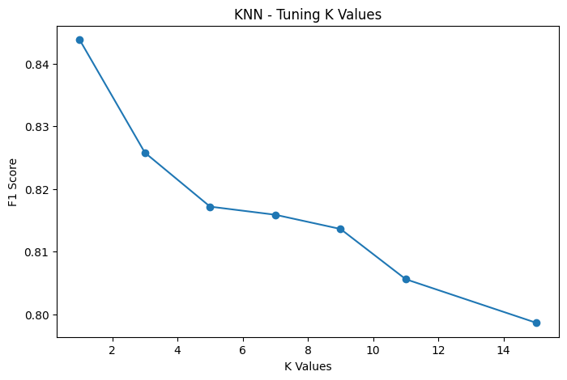
  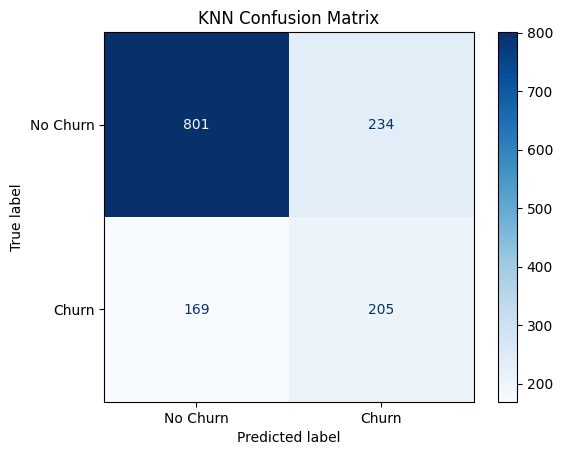
  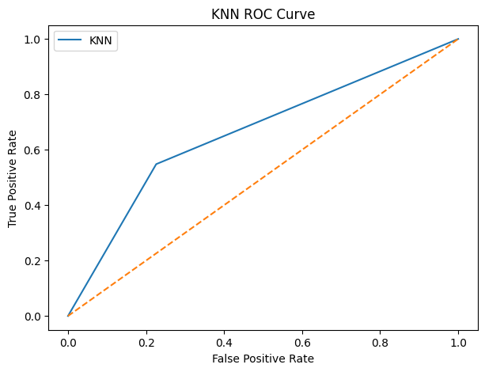
</p>

### 4.2 Gaussian Naive Bayes

<details>
<summary>📌 Main code — GaussianNB, metrics, class priors</summary>

```python
from sklearn.naive_bayes import GaussianNB

nb_model = GaussianNB()                       # default parameters
nb_model.fit(X_train_smote, y_train_smote)
y_pred_nb = nb_model.predict(X_test_scaled)
y_prob_nb = nb_model.predict_proba(X_test_scaled)[:, 1]

print("Accuracy:", accuracy_score(y_test, y_pred_nb))    # 0.7204
print("Precision:", precision_score(y_test, y_pred_nb))   # 0.4839
print("Recall:", recall_score(y_test, y_pred_nb))         # 0.8021  ← best recall so far
print("F1:", f1_score(y_test, y_pred_nb))                 # 0.6036
print("AUC-ROC:", roc_auc_score(y_test, y_prob_nb))       # 0.8180  ← best AUC

print(nb_model.class_prior_)   # [0.5 0.5] — matches SMOTE-balanced train rate
```

> 📝 **Note in notebook:** Naive Bayes assumes feature independence. With one-hot/encoded telecom features this assumption doesn't fully hold — yet NB still posts the best AUC-ROC and Recall, because churn signal is dominated by a few strong features (contract, tenure).

</details>

<p align="center">
  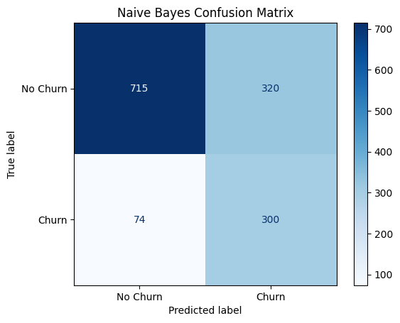
  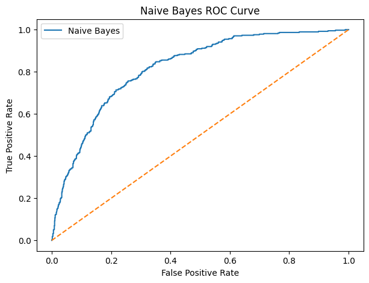
</p>

---

<a id="step-5"></a>
## ⚔️ Step 5 — Model Building: SVM & Decision Tree *(PART E, cells 108–148)*

### 5.1 SVM (RBF kernel, tune C)

<details>
<summary>📌 Main code — SVC baseline, C tuning with cross_val_score, best SVM</summary>

```python
from sklearn.svm import SVC

svm = SVC(kernel='rbf', C=1, gamma='scale', probability=True, random_state=42)
svm.fit(X_train_smote, y_train_smote)
# baseline: Acc 0.7587 · P 0.5321 · R 0.7540 · F1 0.6239 · AUC 0.8260

# Tune C with 3-fold CV (scoring='f1')
C_values = [0.1, 1, 10, 100]
for C in C_values:
    scores = cross_val_score(SVC(kernel='rbf', C=C, gamma='scale', probability=True,
                                 random_state=42),
                             X_train_smote, y_train_smote, cv=3, scoring='f1')
    print(C, scores.mean())
# C=10 wins (CV F1 0.8251)

best_svm = SVC(kernel='rbf', C=10, gamma='scale', probability=True, random_state=42)
best_svm.fit(X_train_smote, y_train_smote)
# test: Acc 0.7587 · P 0.5373 · R 0.6551 · F1 0.5904 · AUC 0.8042
```

> 📝 **Notebook note:** SVM is a **black-box** — it can learn complex patterns (high performance) but, unlike a Decision Tree, it's hard to explain *exactly which feature* drove a prediction to the business team. That's the classic **interpretability vs performance** tradeoff.

</details>

<p align="center">
  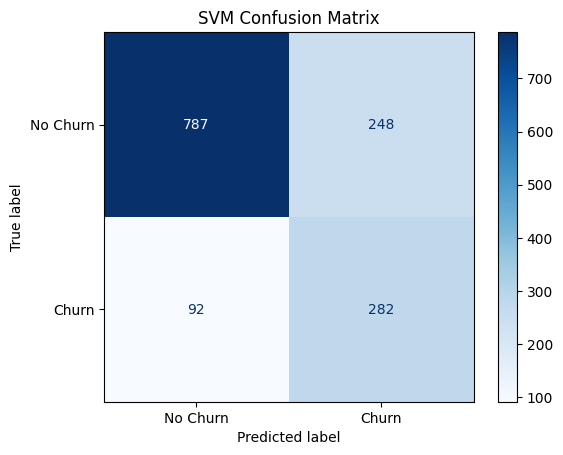
  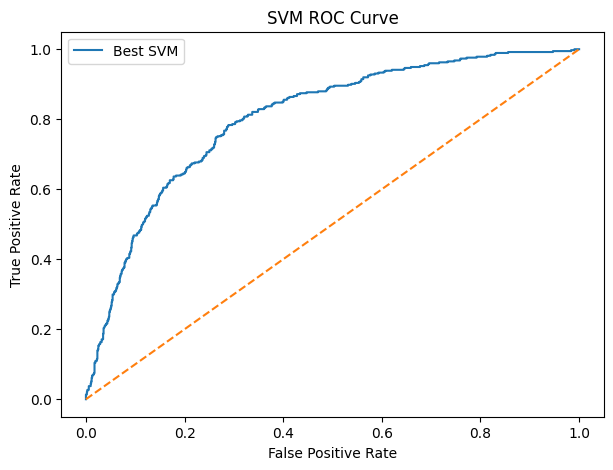
</p>

### 5.2 Decision Tree (tune max_depth, visualize, feature importance)

<details>
<summary>📌 Main code — DT, depth tuning, plot_tree root split, top-15 importances</summary>

```python
from sklearn.tree import DecisionTreeClassifier, plot_tree

dt_model = DecisionTreeClassifier(max_depth=5, class_weight='balanced', random_state=42)
dt_model.fit(X_train_smote, y_train_smote)
# Acc 0.7516 · P 0.5227 · R 0.7380 · F1 0.6120 · AUC 0.8194

# Tune max_depth
depth_values = [3, 4, 5, 6, 7, 8, None]
# ... cross_val_score(scoring='f1') ...
best_depth = depth_values[dt_f1_scores.index(max(dt_f1_scores))]   # → 8 (CV F1 0.7794)

# Root split of the tree
root_feature = X_train_smote.columns[dt_model.tree_.feature[0]]
print(root_feature)   # → Contract_Two year

# Feature importance (top 15)
feature_importance = pd.DataFrame({'Feature': X_train_smote.columns,
                                   'Importance': dt_model.feature_importances_}
                                 ).sort_values('Importance', ascending=False)
```

```text
Top 5 Important Features:
                 Feature  Importance
22   Contract_Two year    0.391520   ← root split
21   Contract_One year    0.303079
20   InternetService_Fiber optic  0.097395
4                 tenure    0.043391
13       PaperlessBilling    0.041042
```

</details>

<p align="center">
  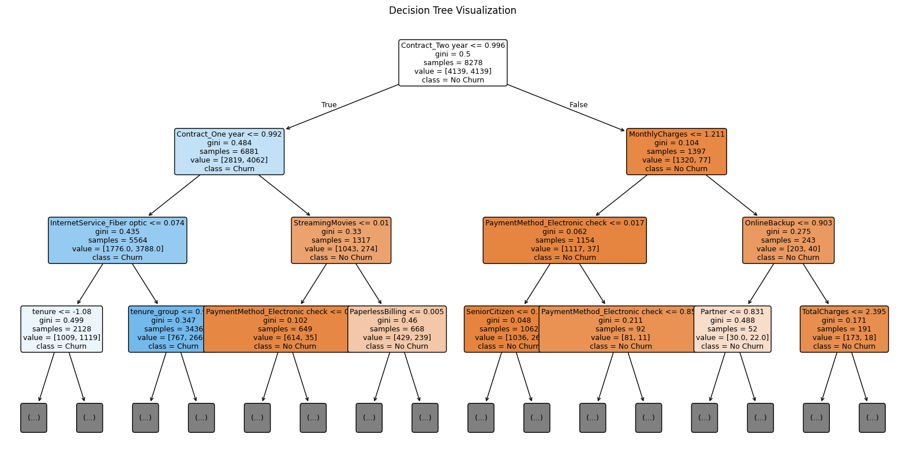
</p>

> 🎛️ **max_depth tuning** (printed table in the notebook): depth 3 → F1 0.7585 … **depth 8 → F1 0.7794 (best)** … depth None → 0.7773, so the final tree uses `max_depth=8`.
<p align="center">
  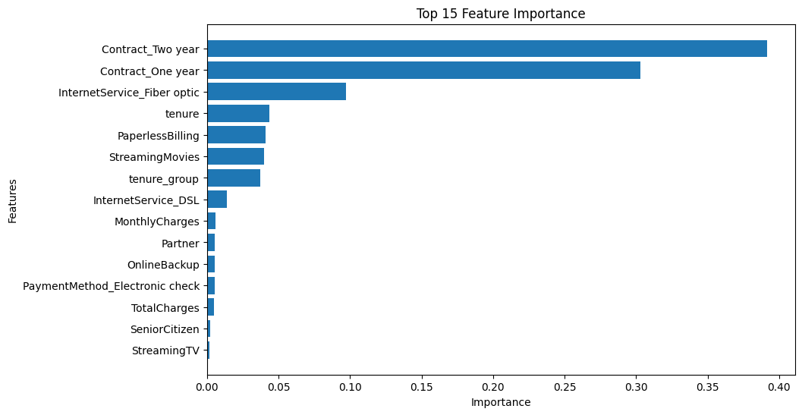
  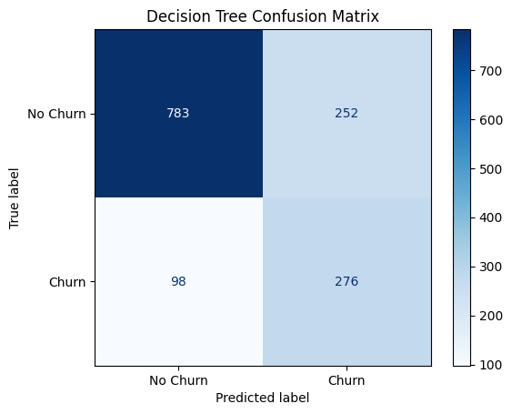
  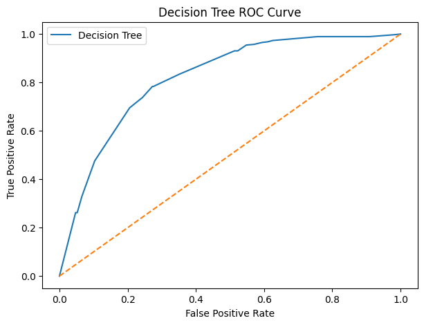
</p>

### 5.3 SMOTE vs `class_weight='balanced'` — head-to-head

<details>
<summary>📌 Main code — same Decision Tree trained both ways, compare Churn Recall</summary>

```python
# Model 1: trained on SMOTE-augmented data
model_smote = DecisionTreeClassifier(max_depth=5, random_state=42)
model_smote.fit(X_train_smote, y_train_smote)

# Model 2: original imbalanced data + class_weight='balanced'
model_weight = DecisionTreeClassifier(max_depth=5, class_weight='balanced', random_state=42)
model_weight.fit(X_train_scaled, y_train)

recall_smote  = recall_score(y_test, model_smote.predict(X_test_scaled))    # 0.7380
recall_weight = recall_score(y_test, model_weight.predict(X_test_scaled))   # 0.8075 ← better
```

```text
Recall using SMOTE: 0.7379679144385026
Recall using class_weight: 0.8074866310160428
→ class_weight gives better Recall
```

**Conclusion:** prefer the approach with higher Churn Recall while also weighing Precision and business cost — here **`class_weight='balanced'` wins** (no synthetic data, better recall).

</details>

---

<a id="step-6"></a>
## 🏆 Step 6 — Model Evaluation & Comparison *(PART F, cells 149–157)*

<details>
<summary>📌 Main code — consolidated comparison table (sorted by Recall) + ROC overlay + Precision/Recall bars</summary>

```python
import time
models = {
    "KNN": KNeighborsClassifier(n_neighbors=best_k),
    "Naive Bayes": GaussianNB(),
    "SVM": SVC(kernel='rbf', C=best_C, gamma='scale', probability=True, random_state=42),
    "Decision Tree": DecisionTreeClassifier(max_depth=best_depth,
                                            class_weight='balanced', random_state=42),
}
results = []
for name, model in models.items():
    t0 = time.time(); model.fit(X_train_smote, y_train_smote); dt = time.time() - t0
    y_pred = model.predict(X_test_scaled)
    y_prob = model.predict_proba(X_test_scaled)[:, 1]
    results.append({'Model': name,
                    'Accuracy': accuracy_score(y_test, y_pred),
                    'Precision': precision_score(y_test, y_pred),
                    'Recall': recall_score(y_test, y_pred),          # Churn class — most important
                    'F1-Score': f1_score(y_test, y_pred),
                    'AUC-ROC': roc_auc_score(y_test, y_prob),
                    'Training Time (seconds)': dt})
comparison_df = pd.DataFrame(results).sort_values('Recall', ascending=False)
print(comparison_df.round(4))

# All 4 ROC curves on one figure + grouped Precision-vs-Recall bar chart
```

</details>

### 📊 Consolidated comparison (real test-set results, sorted by Recall ↓)

| Model | Accuracy | Precision | **Recall (Churn)** | F1-Score | AUC-ROC | Training Time (s) |
|---|---|---|---|---|---|---|
| 🥇 **Naive Bayes** | 0.7204 | 0.4839 | **0.8021** | 0.6036 | **0.8180** | 0.0123 |
| 🥈 Decision Tree | 0.7495 | 0.5211 | 0.6925 | 0.5947 | 0.7967 | 0.0734 |
| 🥉 SVM | 0.7587 | 0.5373 | 0.6551 | 0.5904 | 0.8042 | 23.2790 |
| 4️⃣ KNN | 0.7140 | 0.4670 | 0.5481 | 0.5043 | 0.6610 | 0.0094 |

<p align="center">
  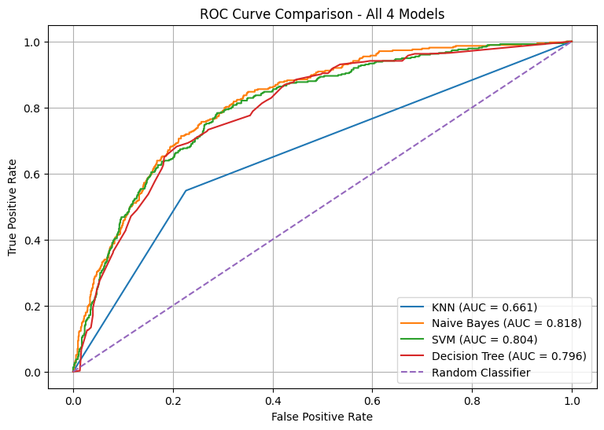
  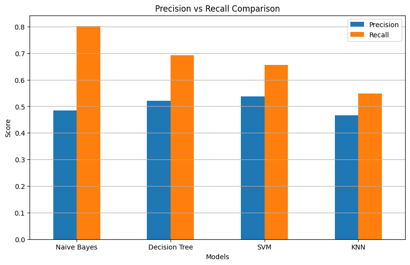
</p>

<p align="center">
  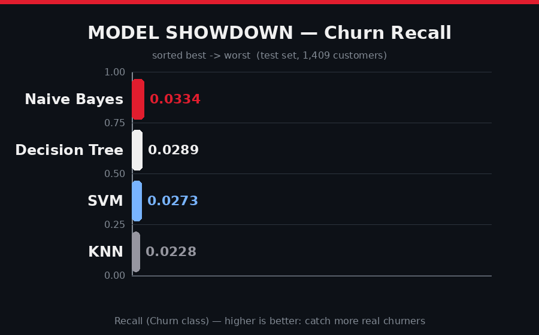
</p>

**Reading the table:** Naive Bayes catches **80.2%** of real churners with the best AUC (0.818) and trains in **12 ms**. SVM is most accurate (0.759) but slow (**23.3 s**) and lower recall. KNN is fastest but weakest (AUC 0.661 — its k=1 tuning overfit the SMOTE data).

---

<a id="step-7"></a>
## 🔍 Step 7 — Error Analysis & Interpretation *(PART G, cells 158–179)*

### 7.1 False-Negative profiling on the best model (Naive Bayes)

<details>
<summary>📌 Main code — isolate FNs, profile them vs all actual churners</summary>

```python
best_model_name = comparison_df.iloc[0]['Model']        # → "Naive Bayes"
best_model = trained_models[best_model_name]
y_pred_best = best_model.predict(X_test_scaled)

error_df = pd.DataFrame({'Actual': y_test, 'Predicted': y_pred_best}, index=y_test.index)
false_negatives = error_df[(error_df['Actual'] == 1) & (error_df['Predicted'] == 0)]
print("Total False Negatives:", len(false_negatives))    # → 74

raw_df = pd.read_csv("WA_Fn-UseC_-Telco-Customer-Churn.csv")
fn_data = raw_df.loc[false_negatives.index].copy()
all_churners = raw_df.loc[y_test[y_test == 1].index].copy()
# compare avg tenure, avg MonthlyCharges, Contract distribution of both groups
```

```text
FALSE NEGATIVE CUSTOMER PROFILE        vs   OVERALL CHURNER PROFILE
Average Tenure:        36.65 months         16.46 months
Average MonthlyCharges: 74.70               72.77
Contract: One year 33 · M2M 32 · Two year 9   M2M 329 (87.97%) · One year 36 · Two year 9

FN contract %:   One year 44.59% · M2M 43.24% · Two year 12.16%
Churner %:       M2M 87.97% · One year 9.63% · Two year 2.41%
```

</details>

> 🔎 **Observation:** the model's 74 missed churners are **longer-tenure (avg 36.6 months), higher-paying, contract-locked customers** — the opposite of the classic "new month-to-month" churner. The model is great at catching obvious churners but misses **"quiet" churners** who leave despite long tenure. The retention team should give this segment extra attention.

### 7.2 Feature importance & business insights

<p align="center">
  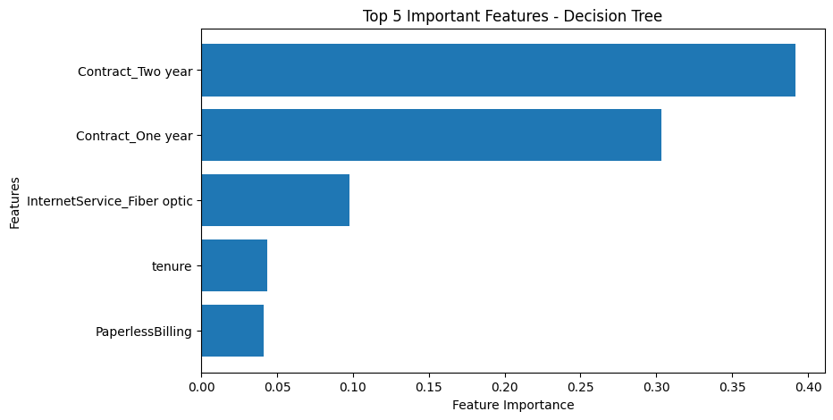
  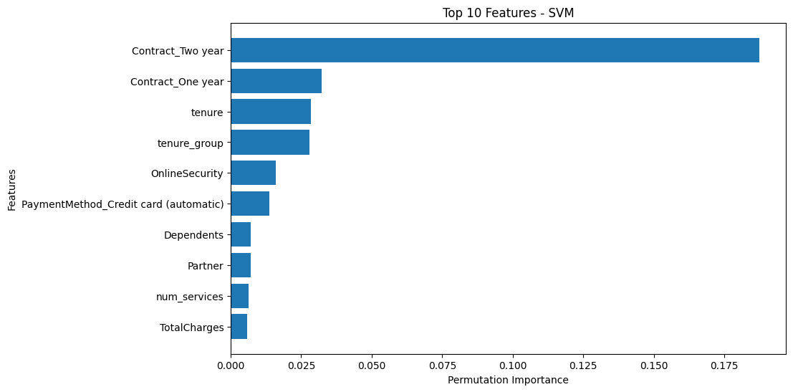
</p>

**Top 5 split features (Decision Tree)** — and what they mean for the business:

| Feature | Importance | Business meaning |
|---|---|---|
| `Contract_Two year` | 0.392 | Root split — customers on 2-year contracts almost never churn (2.8%) |
| `Contract_One year` | 0.303 | 1-year contracts are the middle-risk group (11.3% churn) |
| `InternetService_Fiber optic` | 0.097 | Fiber customers churn more than DSL — worth investigating service quality |
| `tenure` | 0.043 | New customers (0–12 months) are the most volatile |
| `PaperlessBilling` | 0.041 | Paperless billing correlates with higher churn |

**💼 Business-friendly bullets (from the notebook):**

- 📄 **"Customers on Month-to-Month contracts appear in the first split — they are far more likely to churn than those on 2-year contracts."** (42.7% vs 2.8%)
- 🍼 New customers (tenure < 12 months) churn at ~47% — onboard them aggressively in the first year.
- 💳 Fiber-optic + high MonthlyCharges customers are price-sensitive — target them with plan optimization offers.
- 🛡️ Encourage auto-pay and longer contracts — `AutoPay` and contract length are strong retention levers.
- 🔁 More add-on services (`num_services`) → stickier customers.

---

<a id="step-8"></a>
## 🚀 Step 8 — Pipeline, Deployment & GitHub Submission *(cells 180–186)*

<details>
<summary>📌 Main code — wrap best model in a sklearn Pipeline, save with joblib, reload & predict 5 customers</summary>

```python
import joblib
from sklearn.pipeline import Pipeline
from sklearn.base import clone
from sklearn.preprocessing import FunctionTransformer

pipeline = Pipeline([
    ('preprocessor', FunctionTransformer(validate=False)),
    ('model', clone(best_model))          # best_model = Naive Bayes
])
pipeline.fit(X_train_smote, y_train_smote)
joblib.dump(pipeline, 'churn_model.pkl')  # ✅ saved

# --- later / in production ---
loaded_pipeline = joblib.load('churn_model.pkl')
sample_customers = X_test_scaled.head(5)
probs = loaded_pipeline.predict_proba(sample_customers)
preds = loaded_pipeline.predict(sample_customers)
churn_index = list(loaded_pipeline.classes_).index(1)
for i in range(5):
    print(f"Customer {i+1}: Churn Probability {probs[i][churn_index]*100:.2f}% "
          f"→ Predicted Churn: {'Yes' if preds[i]==1 else 'No'}")
```

```text
Customer 1  → Churn Probability: 0.00%   → No
Customer 2  → Churn Probability: 99.17%  → Yes
Customer 3  → Churn Probability: 0.00%   → No
Customer 4  → Churn Probability: 98.07%  → Yes
Customer 5  → Churn Probability: 0.00%   → No
```

</details>

The whole project (notebook + dataset + this README + `churn_model.pkl`) is submitted on **GitHub**: 🔗 [jeelprajapati0606/customer_churn_prediction](https://github.com/jeelprajapati0606/customer_churn_prediction)

---

<a id="results"></a>
## 📈 Final Results Dashboard

| 🎯 Metric | 🥇 Winner | Value |
|---|---|---|
| Recall (Churn) — primary | **Naive Bayes** | **0.8021** |
| AUC-ROC | **Naive Bayes** | **0.8180** |
| Accuracy | SVM | 0.7587 |
| Precision | SVM | 0.5373 |
| Training speed | KNN | 0.0094 s (SVM slowest: 23.28 s) |
| Interpretability | **Decision Tree** | root split = `Contract_Two year` |
| SMOTE vs class_weight | **class_weight** | Recall 0.8075 vs 0.7380 |

<p align="center">
  
</p>

---

<a id="recommendation"></a>
## 💼 Business Recommendation

> Based on the comparison, **Naive Bayes achieved the highest Recall for the Churn class (0.8021) and the best AUC-ROC (0.8180) while training in ~12 ms.** High recall matters because it helps the retention team **identify more customers who are likely to leave** — and a missed churner (FN) is the costliest error.
>
> If **interpretability** is the top priority for the business team, the **Decision Tree** is a strong alternative: its rules are human-readable (root split: `Contract_Two year`), with 0.6925 recall and a full feature-importance story. SVM offers the best raw accuracy but is a **black box** and ~2000× slower to train.
>
> **Recommendation: deploy Naive Bayes** (best Recall + AUC + latency), keep the Decision Tree as the explainability layer for the retention team, and monitor Precision (0.48) since the team can only act on ~25% of flagged customers.

---

<a id="run"></a>
## ▶️ How to Run

```bash
# 1. Clone the repository
git clone https://github.com/jeelprajapati0606/customer_churn_prediction.git
cd customer_churn_prediction

# 2. Create environment & install dependencies
python -m venv .venv
source .venv/bin/activate        # Windows: .venv\Scripts\activate
pip install -r requirements.txt

# 3. Launch the notebook
jupyter notebook Customer_Churn_Prediction/telco_customer_churn-checkpoint.ipynb
#    — or click the "Open in Colab" button at the top of this README ☝️

# 4. Run all cells top-to-bottom (Kernel → Restart & Run All)
#    → regenerates every plot in assets/plots/ and churn_model.pkl
```

**Use the saved model in production:**

```python
import joblib
pipeline = joblib.load('churn_model.pkl')
proba = pipeline.predict_proba(new_customers)[:, 1]   # churn probability
label = pipeline.predict(new_customers)                # 1 = churn, 0 = stay
```

**requirements.txt**

```text
pandas>=2.0
numpy>=1.24
matplotlib>=3.7
seaborn>=0.13
scikit-learn>=1.3
imbalanced-learn>=0.11
joblib>=1.3
jupyter>=1.0
```

---

<a id="checklist"></a>
## ✅ Exam Submission Checklist

| Exam step | Notebook part | Where in this README | Status |
|---|---|---|---|
| Step 1: Problem framing & theory (Q1–Q5) | PART A | [Step 1](#step-1) | ✅ |
| Step 2: Load & EDA (2.1–2.3) | PART B | [Step 2](#step-2) | ✅ |
| Step 3: Preprocessing (3.1–3.6: clean, features, encode, scale, SMOTE, split) | PART C | [Step 3](#step-3) | ✅ |
| Step 4: KNN (k=5 baseline, tune k, CM, ROC) + Naive Bayes (priors, CM, ROC) | PART D | [Step 4](#step-4) | ✅ |
| Step 5: SVM (tune C) + Decision Tree (tune depth, plot_tree, importances) + SMOTE vs class_weight | PART E | [Step 5](#step-5) | ✅ |
| Step 6: comparison table (Recall-sorted), ROC overlay, P-vs-R chart, recommendation | PART F | [Step 6](#step-6) | ✅ |
| Step 7: FN error analysis + top-5 features + business insights (+ permutation bonus) | PART G | [Step 7](#step-7) | ✅ |
| Step 8: sklearn Pipeline → joblib `churn_model.pkl` → load & predict 5 samples → GitHub | cells 180–186 | [Step 8](#step-8) | ✅ |

---

## 👨‍💻 Author

<p align="center">
  <a href="https://github.com/jeelprajapati0606"></a><br>
  <b>Jeel Prajapati</b> — Junior Data Scientist (exam persona) 👨‍💻<br>
  <a href="https://github.com/jeelprajapati0606/customer_churn_prediction">🔗 GitHub Repository</a> ·
  <a href="https://www.kaggle.com/datasets/blastchar/telco-customer-churn">📊 Kaggle Dataset</a>
</p>

---

<p align="center">
  <br>
  <i>"Quality is our Motto — Practical Exam: Supervised Learning (Set B). Shaping skills to scale higher."</i><br><br>
  ⭐ If this project helped you, please star the repo! ⭐
</p>

<p align="center">
  <a href="#top">⬆️ Back to top</a>
</p>
